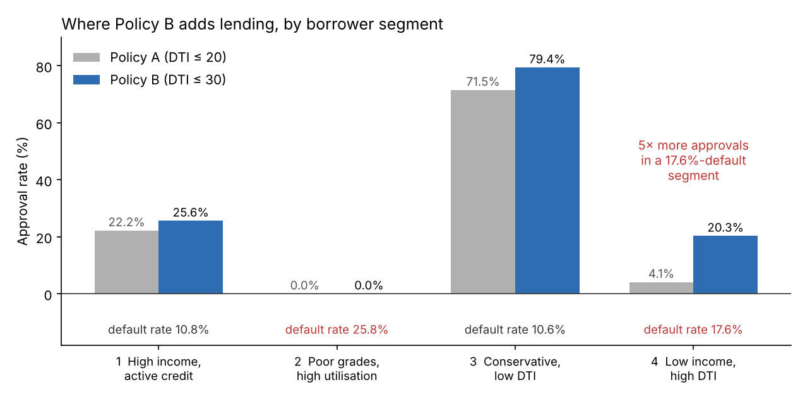

# Lending Policy Evaluation & Borrower Segmentation

**Should a lender relax its debt-to-income limit?** An A/B evaluation on 50,000 LendingClub loans shows the looser policy earns **£61 more profit per application**. Borrower segmentation reveals the hidden cost: almost all the extra lending goes to one **low-income, high-debt segment with a 17.6% default rate**, where approvals rise five-fold.



## Business problem

A consumer lender issuing unsecured personal loans was considering relaxing its approval rules to grow volume. Management needed to know whether the change would increase profit, and where the extra risk would land.

## Data

- 50,000 LendingClub loans issued in 2012–2013, with 57 variables and a known outcome (`loan_is_bad`: default or charged off)
- 31 rows with missing key fields were dropped, leaving 49,969 loans
- *The data file is not included; see [`data/README.md`](data/README.md).*

## Approach

**1. A/B evaluation of two approval policies**

| Criterion | Policy A (conservative) | Policy B (growth) |
|---|---|---|
| Loan grade | A, B or C | A, B or C |
| Annual income | ≥ 40,000 | ≥ 40,000 |
| Revolving utilisation | ≤ 60% | ≤ 60% |
| **Debt-to-income** | **≤ 20** | **≤ 30** |

- Primary metric: **average profit per application**, where profit is total repaid minus the amount funded. It captures both approval volume and loan losses in one number.
- Statistical test: a paired t-test comparing the two policies.

**2. Borrower segmentation (cluster analysis)**
- **Variables.** Four variables cover distinct risk dimensions: credit grade (A–G, encoded 1–7), log annual income, debt-to-income ratio and revolving utilisation.
- **Outliers.** Multivariate outliers were removed using Mahalanobis distance (p < 0.001, 152 loans).
- **Correlations.** All pairwise correlations were 0.40 or below.
- **Choosing the number of clusters.** A Ward hierarchical clustering dendrogram, the elbow method and the gap statistic all pointed to 4 clusters.
- **Final model.** K-means with k = 4 on standardised variables explains 47% of the total variation.

**3. Deep learning default model (team prototype)**
- A PyTorch neural network using 38 features available when the loan is issued
- Class imbalance handled by weighting the loss
- Stratified 70/15/15 train, validation and test split

## Results

**The A/B test favours Policy B on profit.**

| Metric | Policy A | Policy B | Change |
|---|---|---|---|
| Approval rate | 24.2% | 32.1% | +32% relative |
| Default rate (approved loans) | 9.9% | 10.7% | +0.8 pp |
| **Avg profit per application** | £214 | £275 | **+£61.47** (95% CI £52.10–£70.84, p < 0.001) |

Policy B approves an extra 3,935 loans. They default more often (13.1%), but 81% are still profitable, at about £781 each on average.

**The segmentation shows where the extra risk goes.**

| Segment | Size | Avg income | DTI | Default rate | Approval A → B |
|---|---|---|---|---|---|
| 1. High income, active credit users | 13,137 | £97,807 | 14.0 | 10.8% | 22.2% → 25.6% |
| 2. Poor grades, high utilisation | 9,058 | £75,213 | 18.3 | **25.8%** | 0% → 0% |
| 3. Conservative, low DTI | 11,922 | £66,752 | 11.7 | 10.6% | 71.5% → 79.4% |
| 4. Low income, high DTI | 15,700 | £46,008 | 24.1 | **17.6%** | **4.1% → 20.3%** |

- The grade and utilisation rules already shut out the riskiest segment (2) under both policies.
- Relaxing DTI mostly opens lending to **Segment 4**, which has the next-highest default rate. The overall averages don't show this.

**The deep learning prototype ranks risk modestly well.**
- On the test set it reached an **AUC of 0.66**.
- Approving only applicants with a predicted default probability below 0.25 cuts the default rate among approved loans to 4.8% (from 9.5% under Policy A), but approves only 9.1% of applicants.

## Recommendation

**Adopt Policy B in stages, by segment:**
1. Start with Segments 1 and 3: the extra lending there is profitable and low-risk.
2. Extend to Segment 4 with tighter sub-rules and closer monitoring.
3. Confirm with a randomised live trial before full rollout, because the historical data contains only loans that were actually issued.

## My role

This was a seven-person group project for *Advanced Data Analytics* on the MSc Business Analytics at Warwick Business School (2026). **I led the borrower segmentation (Q2):**
- choosing and engineering the variables
- Mahalanobis outlier removal
- choosing the number of clusters using the dendrogram, elbow method and gap statistic
- k-means clustering and profiling the segments
- analysing policy performance by segment, which produced the key finding about Segment 4

The A/B test (Q1) and the deep learning model (Q3) were built by teammates and are included for the full picture.

## Limitations

- The data is observational, not from a randomised experiment, and only covers loans that were issued. Outcomes for applicants only Policy B would approve are inferred from similar historical borrowers.
- Profit ignores operating costs, servicing costs and the time value of money.
- The deep learning notebook re-creates the clusters in Python, so its segment numbers don't line up exactly with the R analysis.

## Repository structure

```
├── analysis/loan_policy_and_segmentation.Rmd   # A/B test + cluster analysis (R)
├── notebooks/default_prediction_dnn.ipynb      # deep learning prototype (Python / PyTorch, team)
├── data/README.md                              # where to get the data
└── images/policy_by_cluster.png
```

## Tools

R (tidyverse, cluster, factoextra, psych) · Python (PyTorch, scikit-learn, pandas) · A/B testing · K-means · Hierarchical clustering
