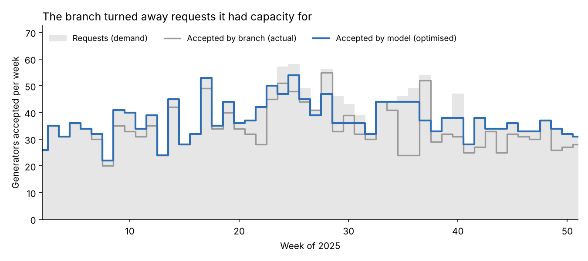
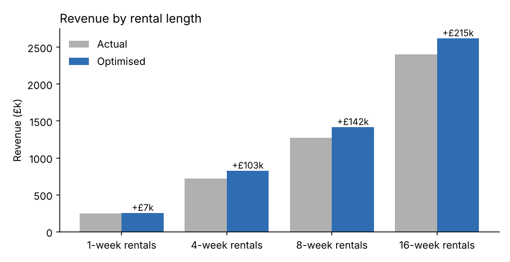

# Revenue Management for a Generator Rental Branch

**A linear programming model that decides which rental requests to accept each week to maximise revenue from a fixed fleet.** For one UK branch of PowerLease Generators, the optimised plan would have earned **£5.12M instead of £4.65M (+£466k, +10%)**, raised fleet utilisation from 73% to 79%, and lifted ROI from 5.17 to 5.69.



## Business problem

PowerLease Generators (PLG) rents diesel and hybrid generators from 45 branches across the UK and Ireland. Customers ask for 1-, 4-, 8- or 16-week rentals:
- **Short rentals pay the most per day:** 1-week rentals earn about £75/day.
- **Long rentals pay less per day but tie up a unit for months:** 16-week rentals earn about £48/day.

Each week, branch managers decide which requests to accept with a fixed fleet of 300 generators. PLG wanted to know whether **revenue management**, the technique airlines and hotels use to decide which bookings to take, could improve those decisions.

## Data

- One branch for 2025: 52 weeks, of which weeks 1 and 52 were closed for holidays.
- **For each week and rental length:** price per day, number of requests, number the branch actually accepted, and units returned.
- **Fleet and costs:** 300 generators costing £3,000 each, with 77 available at the start of the year.

## The model

| Element | Definition |
|---|---|
| **Resource** | Generators available in each week |
| **Products** | 1-, 4-, 8- and 16-week rentals, each priced per day and varying by week |
| **Decision variable** | `x[t,p]`: number of rental requests of length *p* accepted in week *t* (integer) |
| **Objective** | Maximise Σ `x[t,p]` × duration(*p*) × 7 × price(*t,p*) |
| **Demand** | `x[t,p]` ≤ requests received |
| **Inventory balance** | Available(*t*) = Available(*t−1*) − accepted(*t−1*) + units returning in week *t* |
| **Capacity** | Total accepted in week *t* ≤ available in week *t* |

Returns come from rentals accepted during the year (for example, a 4-week rental accepted in week 10 returns in week 14) and from rentals booked before the year began. The model is built in **Python with Pyomo** and solved with HiGHS (or GLPK if HiGHS isn't installed).

## Results

| Metric | Actual 2025 | Optimised | Change |
|---|---|---|---|
| Total revenue | £4,650,479 | £5,116,909 | **+£466,430 (+10.0%)** |
| Load factor (fleet utilisation) | 73.4% | 79.1% | +5.7 pts |
| ROI (revenue per unit ÷ unit cost) | 5.17 | 5.69 | +0.52 |
| Requests accepted | 87.8% | 95.8% | +8.0 pts |



**What drives the gain:** most of the uplift comes from **accepting requests the branch turned away even though it had generators free**, especially in the second half of the year. In weeks 35–36, for example, the branch accepted only 24 of about 47 requests, while the model accepted 44. Every rental length gains revenue. The largest gains are on the long 8- and 16-week rentals, because each of those requests is worth the most in total.

## What this means for PLG

- **The main win is operational.** Branch managers should see how many units are free each week before rejecting a request. A simple weekly availability view would capture much of the gain.
- **In practice, a branch would run the model weekly** on a demand forecast. It would set **booking limits** for each rental length: for example, cap 16-week rentals before a peak so units stay free for higher-paying short rentals.
- **Scale:** if other branches behave like this one, the opportunity across 45 branches is significant. It should be tested on more branches before anyone projects it.

## Limitations

- **The model knows the future.** It sees the whole year's demand in advance; a real branch manager doesn't. So +10% is the **upper bound** of what better decisions could achieve. A realistic system would re-run the model weekly on forecasts, and some of the gain would be lost to forecast error.
- **Customers who are turned away are assumed to be lost.** In reality, some might accept a different rental length or date.
- **Prices are fixed at the observed rates.** The model only decides which requests to accept, not what to charge. Combining it with dynamic pricing is a natural next step.
- **Load factor isn't measured the same way on both sides.** The actual figure averages all 52 weeks, including the closed ones; the optimised figure covers the 50 open weeks. The effect is small.
- Rentals that run past year-end earn their full revenue in the year they're booked, for both the actual and optimised figures.

## How to run

```bash
pip install pyomo highspy pandas openpyxl matplotlib
python src/revenue_management.py
```

Results are written to `outputs/kpis.csv` and `outputs/weekly_plan.csv` (actual vs optimised acceptances for every week and rental length).

## Repository structure

```
├── src/revenue_management.py   # model: data loading, LP, KPIs, weekly plan
├── src/original_model.py       # original group-assignment version (same results)
├── data/plg_branch_2025.xlsx   # branch data for 2025
├── outputs/                    # KPIs and weekly acceptance plan
└── images/                     # README charts
```

## My role

This was a group project for *Pricing Analytics* on the MSc Business Analytics at Warwick Business School (2026).
**I worked on the modelling (Q2):**
- defining the resources and products
- formulating the linear programming model: decision variables, revenue objective, and the demand, inventory-balance and capacity constraints
- implementing it in Python with Pyomo
- comparing optimised revenue, load factor and ROI with the branch's actual 2025 results

The suitability assessment, implementation plan and presentation were team efforts.

## Tools

Python · Pyomo · HiGHS / GLPK · pandas · Linear & integer programming · Revenue management
